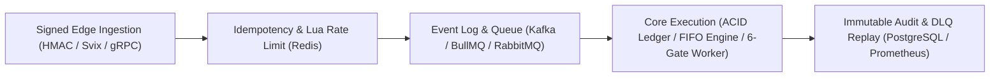

# Mohamed Arafa

**Backend & Distributed Systems Engineer** — Cairo / Remote  
[`LinkedIn`](https://www.linkedin.com/in/mohamed-arafa-6628211b8/) · [`mohamed3rafa01@gmail.com`](mailto:mohamed3rafa01@gmail.com) · [`npm: agentic-json-repair`](https://www.npmjs.com/package/agentic-json-repair)

> I architect fault-tolerant backend infrastructure, financial settlement engines, and high-throughput webhook pipelines in **TypeScript, Node.js, and NestJS**. My work centers on invariant-driven design: ACID double-entry ledgers, deterministic matching engines, exactly-once event ingestion, and multi-tenant isolation under burst load.

---

## Core Architectural Pattern

---

## Production Systems & Case Studies

### 01 · [Matchbook](https://github.com/mo74x/matchbook) — Event-Sourced Order Matching Engine
`TypeScript` · `Node.js` · `PostgreSQL 15` · `Event Sourcing` · `Prometheus` · `Grafana`

* **Throughput & Determinism:** Synchronous Price-Time Priority (FIFO) matching engine sustaining **18,700+ ops/sec** with sub-millisecond execution across `LIMIT`, `MARKET`, `IOC`, and `FOK` orders and real-time L2 order book depth aggregation.
* **Zero-Loss State Recovery:** Append-only `OrderEvent` log paired with periodic `OrderBookSnapshot` checkpoints for deterministic replay after process crashes.
* **Blast-Radius Isolation:** Per-instrument execution queues protected by automated circuit breakers and p99 latency telemetry.

---

### 02 · [Invoice Chaser](https://github.com/mo74x/invoice-chaser) — Autonomous B2B Dunning & Revenue Recovery Engine
`NestJS 11` · `Prisma 7` · `PostgreSQL 16` · `Redis 7 / BullMQ` · `Stripe OAuth` · `Claude AI` · `k6`

* **Six-Gate BullMQ Worker Pipeline:** Orchestrates multi-stage overdue invoice recovery (`STAGE_1`..`STAGE_3`) with database-backed webhook deduplication, live pre-send Stripe invoice verification, timezone-aware business-hour windows, and Dead-Letter Queue (`reminders-dlq`) replay.
* **Hallucination-Checked AI Voice Cloning:** Extracts structured founder tone profiles via Claude and validates every generated draft against strict financial invariants (exact currency amount verification, zero fabricated URLs) with automatic deterministic fallback.
* **Zero-Trust Multi-Tenancy:** AES-256-GCM encrypted Stripe OAuth credentials at rest, JWT-scoped tenant controllers, Svix-signed Resend delivery tracking, inbound reply auto-pause, and k6 load verification (`10,000` invoice storm).

---

### 03 · [FleetPulse](https://github.com/mo74x/Fleetpulse) — Last-Mile Logistics & Double-Entry Settlement Engine
`NestJS` · `PostgreSQL` · `MongoDB` · `Redis (Geo / Redlock)` · `RabbitMQ` · `Elasticsearch`

* **ACID Financial Ledger:** Double-entry settlement engine using PostgreSQL pessimistic row locking (`SELECT ... FOR UPDATE`) to guarantee zero balance drift across courier, merchant, and platform accounts.
* **Concurrency-Safe Geo Dispatch:** Real-time proximity matching via Redis `GEOSEARCH` combined with distributed **Redlock** leases to prevent double-assignment race conditions under concurrent driver claims.
* **Asynchronous Settlement Workers:** Decoupled ingestion and payout pipelines across BullMQ and RabbitMQ with exponential backoff and dead-letter routing.

---

### 04 · [Nexora](https://github.com/mo74x/Nexora) — Multi-Tenant Event Ingestion & Throttling Platform
`Node.js` · `TypeScript` · `gRPC` · `Apache Kafka` · `Redis Lua` · `Docker`

* **Hybrid Transport Layer:** Low-latency internal RPC via **gRPC** paired with high-throughput **Apache Kafka** partitioned event streaming.
* **Noisy-Neighbor Protection:** Atomic per-tenant token-bucket rate limiting executed inside **Redis Lua scripts**, guaranteeing single-roundtrip fairness during traffic spikes.

---

### 05 · Hawala — Distributed FinTech Remittance & Ledger Backend
`NestJS` · `TypeScript` · `PostgreSQL` · `Redis` · `BullMQ`

* **Idempotent Cross-Node Settlement:** Enforces strict idempotency keys and atomic state machines to eliminate double-spending across distributed remittance corridors.
* **Automated Reconciliation:** Asynchronous settlement workers with isolated Dead-Letter Queues for failed transfer inspection and replay.

---

## Published Open-Source Packages

| Package | Version | Engineering Problem Solved |
| :--- | :--- | :--- |
| **[`agentic-json-repair`](https://www.npmjs.com/package/agentic-json-repair)** |  | Zero-dependency TypeScript state machine that deterministically repairs truncated, unescaped, or malformed JSON payloads emitted by LLMs and webhook streams. |

---

## Technical Matrix

  

| Domain | Stack & Primitives |
| :--- | :--- |
| **Languages & Runtimes** | TypeScript · Node.js (v22) · Python · SQL · Lua |
| **Frameworks & RPC** | NestJS · Express.js · gRPC (Protobuf) · GraphQL · REST |
| **Storage & Persistence** | PostgreSQL (`SELECT FOR UPDATE`, WAL PITR) · Prisma 7 · TypeORM · Redis (`Redlock`, `GeoSets`, `Lua`) · MongoDB · Elasticsearch |
| **Messaging & Webhooks** | Apache Kafka · RabbitMQ · BullMQ · Stripe Webhooks & OAuth · Resend / Svix · Transactional Outbox · DLQ Replay |
| **Security & Reliability** | AES-256-GCM Encryption at Rest · JWT Multi-Tenancy · RFC 8058 Unsubscribe · Prometheus · Grafana · Docker · GitHub Actions · k6 |

---

## Engineering Invariants

1. **Never trust the happy path at I/O boundaries:** Every inbound webhook is signature-verified (`Stripe-Signature`, `Svix`), deduplicated at the database constraint layer, and acknowledged before heavy downstream execution.
2. **Financial state requires database-level guarantees:** Balances, invoice states, and ledger postings rely on ACID transactions, pessimistic locks, or live pre-send verification—never optimistic in-memory assumptions.
3. **Every failure must be observable and replayable:** Exhausted background jobs never vanish silently; they transition to structured Dead-Letter Queues with immutable audit logs and Prometheus counters.
