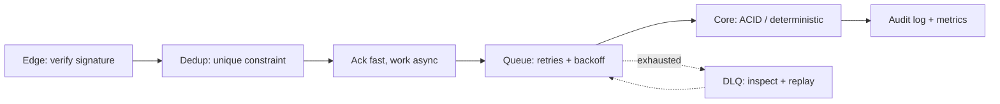

<div align="center">


[LinkedIn](https://www.linkedin.com/in/mohamed-arafa-6628211b8/) &nbsp;·&nbsp; [Email](mailto:mohamed3rafa01@gmail.com) &nbsp;·&nbsp; [npm](https://www.npmjs.com/package/agentic-json-repair)

</div>

```text
$ whoami --verbose
role        backend & distributed systems engineer
stack       typescript · node.js · nestjs · postgresql · redis · kafka
focus       ledgers · idempotency · webhooks · multi-tenancy · queues
believes    "if it isn't idempotent, it isn't done"
status      open to backend / platform / fintech infrastructure roles
```

---

## How I Think About Systems



Every system below follows this shape. Nothing gets processed twice, and failures don't disappear: they end up somewhere you can inspect and replay.

---

## Selected Work

### [Matchbook](https://github.com/mo74x/matchbook) · Event-Sourced Order Matching Engine
`TypeScript` `Node.js` `PostgreSQL` `Prometheus` `Grafana`

| | |
| :--- | :--- |
| **Problem** | A matching engine has to be fast *and* recoverable to the exact same state after a crash. |
| **Decision** | Single-threaded price-time priority (FIFO) core with no I/O in the hot path. Every state change goes to an append-only `OrderEvent` log, with periodic `OrderBookSnapshot` checkpoints. |
| **Result** | **18,700+ ops/sec**. Supports `LIMIT` / `MARKET` / `IOC` / `FOK` orders, L2 depth, and deterministic replay from snapshot + tail. |

### [Invoice Chaser](https://github.com/mo74x/invoice-chaser) · AI Dunning & Revenue Recovery Engine
`NestJS` `Prisma 7` `PostgreSQL` `BullMQ` `Stripe` `Claude` `Resend`

| | |
| :--- | :--- |
| **Problem** | Automated payment reminders are risky: emailing a customer who already paid, double-sending, or letting an LLM invent a payment link. |
| **Decision** | A six-gate worker pipeline (suppression, live Stripe status check, send window, AI generation + validation, approval / daily cap, audited dispatch). LLM output must contain the exact invoice amount and no URLs, and falls back to a template if it fails. |
| **Result** | Tenant isolation through JWT, AES-256-GCM encrypted OAuth tokens, an approval queue, reply-triggered auto-pause, DLQ replay, and a k6 webhook-storm harness with an invariant checker. |

### [FleetPulse](https://github.com/mo74x/Fleetpulse) · Logistics & Double-Entry Settlement
`NestJS` `PostgreSQL` `MongoDB` `Redis` `RabbitMQ` `Elasticsearch`

| | |
| :--- | :--- |
| **Problem** | Two couriers claiming the same order at once, and balances that drift under concurrent payouts. |
| **Decision** | Redis `GEOSEARCH` for proximity plus **Redlock** leases for assignment. Double-entry postings under `SELECT ... FOR UPDATE`. |
| **Result** | No double-assignment, and the ledger always balances across courier, merchant, and platform accounts. |

### [Nexora](https://github.com/mo74x/Nexora) · Multi-Tenant Event Ingestion
`Node.js` `gRPC` `Kafka` `Redis Lua` `Docker`

| | |
| :--- | :--- |
| **Problem** | One noisy tenant can starve everyone else on shared infrastructure. |
| **Decision** | Atomic per-tenant token bucket in a single Redis Lua script. gRPC for internal calls, Kafka for the high-volume stream. |
| **Result** | Fair throttling with one round-trip under burst traffic, so tenant spikes stay isolated. |

### Hawala · Remittance & Ledger Backend
`NestJS` `PostgreSQL` `Redis` `BullMQ`

| | |
| :--- | :--- |
| **Problem** | Retries in distributed settlement can turn into double-spends. |
| **Decision** | Idempotency keys on every transfer, an explicit state machine, and DLQ isolation for failed settlements. |
| **Result** | Retries are safe and every failed transfer can be inspected and replayed. |

---

## Open Source

**[`agentic-json-repair`](https://www.npmjs.com/package/agentic-json-repair)** &nbsp; 

A zero-dependency TypeScript state machine that repairs truncated, unescaped, or malformed JSON from LLMs and webhook streams. I built it because `JSON.parse` failing at 3 AM shouldn't page anyone.

---

## Toolbox

<p align="left">
  
</p>

| Layer | What I reach for |
| :--- | :--- |
| **Core** | TypeScript · Node.js · NestJS · Express · Python · SQL · Lua |
| **Data** | PostgreSQL · Prisma · TypeORM · Redis (Redlock, Geo, Lua) · MongoDB · Elasticsearch |
| **Messaging** | Kafka · RabbitMQ · BullMQ · gRPC · Transactional Outbox · DLQ |
| **Integrations** | Stripe (OAuth, Webhooks) · Resend / Svix · Anthropic Claude |
| **Ops** | Docker · Kubernetes · AWS · GitHub Actions · Prometheus · Grafana · k6 |

---

## Rules I Build By

1. **Verify at the edge, dedupe at the database.** Signatures prove who sent the event, and unique constraints make sure it's processed once.
2. **Money never lives in memory.** Use ACID transactions, row locks, or a live re-check before acting.
3. **Failures are data.** Retry with backoff, then DLQ, audit, alert, and replay. Nothing disappears.
4. **Measure, then claim.** p95 / p99, queue depth, and error counters come before adjectives.

---

<details>
<summary><b>GitHub Telemetry</b></summary>
<br/>
<div align="center">
  
  
</div>
</details>

<div align="center">
<sub>Happy to talk ledgers, queues, and the tricky parts of distributed systems. Find me on <a href="https://www.linkedin.com/in/mohamed-arafa-6628211b8/">LinkedIn</a>.</sub>
</div>
